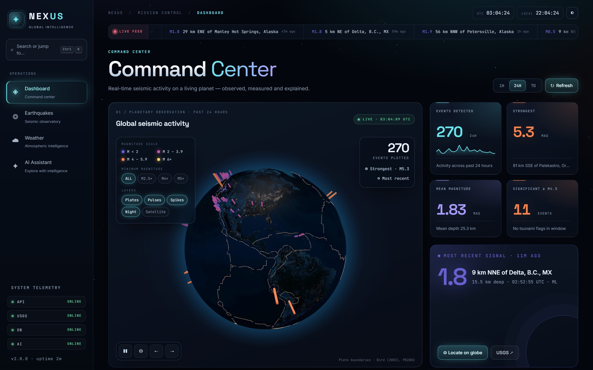
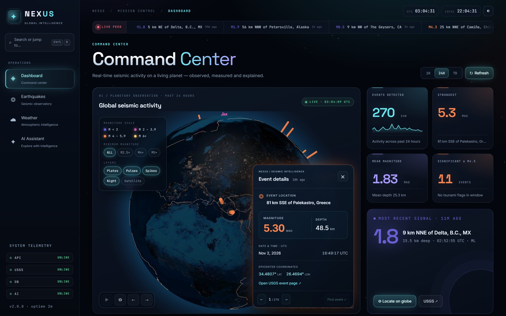
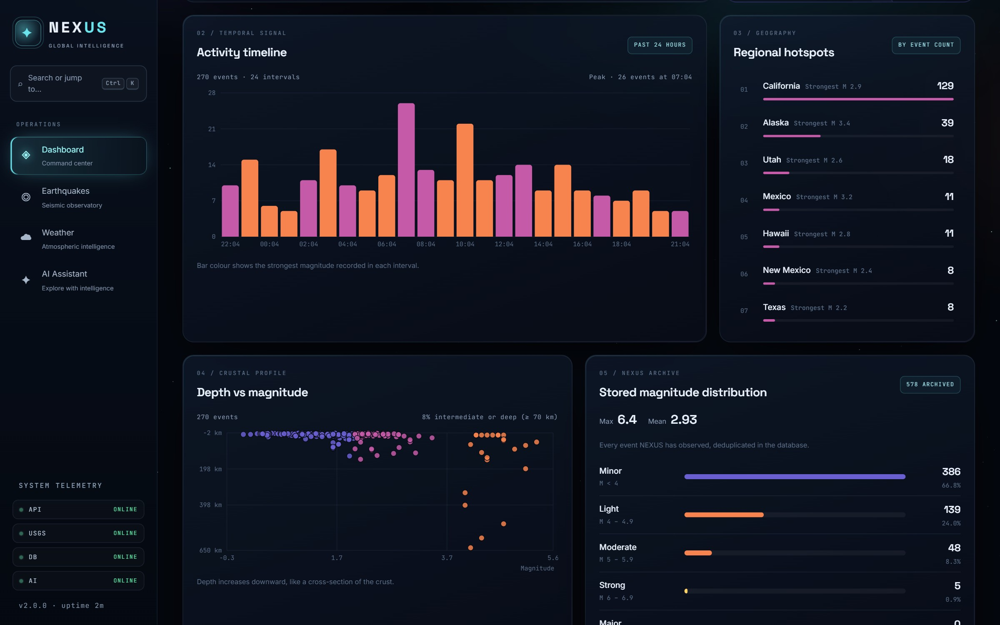
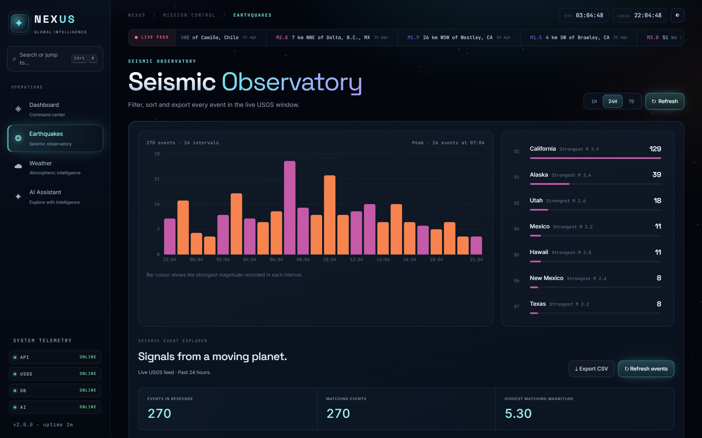
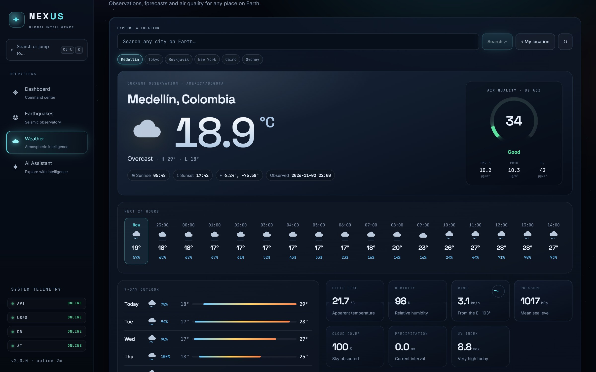
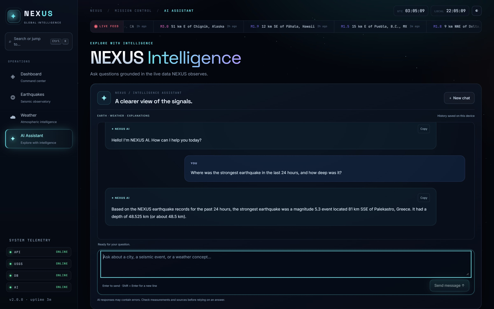
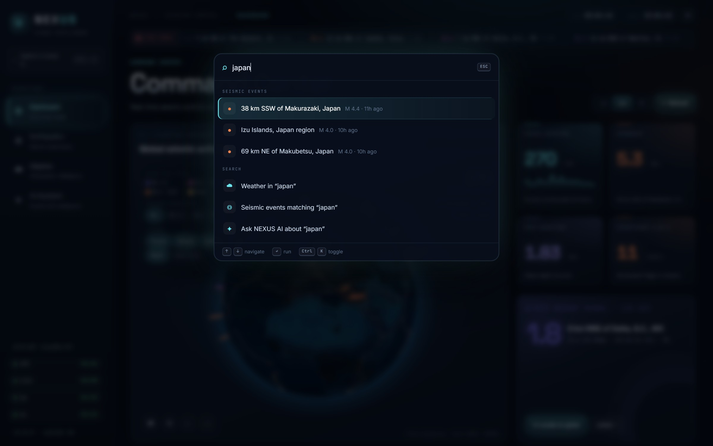
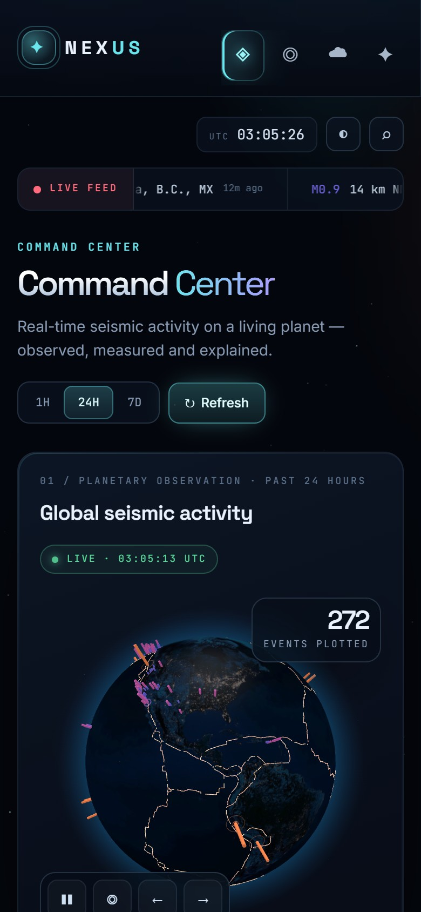

<div align="center">

# NEXUS

**Real-time seismic and atmospheric intelligence on a live 3D globe.**

NEXUS turns public scientific data into a single command center: every earthquake reported by USGS, weather and air quality for any city on Earth, and an AI analyst that answers questions using the same live data.

[](https://github.com/saracastrillons/nexus/actions/workflows/ci.yml)




</div>

## Overview

Earthquake and weather data are public, but they live in separate services, raw formats and long tables. NEXUS brings them together in one interface designed for exploration: you can see where the planet is moving right now, inspect any event in a couple of clicks, and ask follow-up questions in plain language.

The project is a full-stack application: a React front end with a WebGL globe and data visualizations, and a FastAPI back end that aggregates the providers, stores observed events, caches requests and grounds the AI assistant in real data.

## Features

### Live planetary view

Every event in the selected window (past hour, 24 hours or 7 days) is plotted on a 3D globe. Spike height and colour follow magnitude, strong and recent events emit pulses, and tectonic plate boundaries are drawn on top so the patterns are easy to read. Selecting an event flies the camera to the epicenter and opens its details, with a link to the official USGS page.



### Seismic analytics

Indicators update automatically every minute: number of events, strongest event, mean magnitude and depth, and significant events. Below them, an activity timeline, a depth versus magnitude profile, the most active regions and the distribution of every event NEXUS has archived.



### Seismic observatory

A searchable table of every event in the window, with magnitude filters, sorting and pagination. Any row can be located on the globe or exported, together with the current filters, to CSV.



### Atmospheric intelligence

Current conditions, a 24-hour forecast and a 7-day outlook for any city, or for your own location. It also shows air quality (US AQI, PM2.5, PM10 and ozone), UV index, wind direction, pressure, sunrise and sunset.



### AI analyst

A Gemini-powered assistant that answers in English or Spanish. Before the model is called, the back end retrieves the relevant earthquakes or weather observations and computes the key figures (strongest event, averages, counts, whether two observations are simultaneous) in Python. The model explains those results instead of guessing them, so its answers match what the dashboard shows.



### Keyboard first

Press `Ctrl + K` (or `Cmd + K`) to open the command palette. From there you can switch sections, change the time window, fly to the strongest or most recent event, search events by place, open the weather for a city or start a question for the assistant. Keys `1` to `4` switch sections directly.

<p align="center">
  
  
</p>

## Architecture

```text
                 ┌──────────────────────────────────────┐
                 │  React 19 · Vite                     │
                 │  react-globe.gl (Three.js) · Recharts│
                 └──────────────────┬───────────────────┘
                                    │ REST / JSON
                 ┌──────────────────▼───────────────────┐
                 │  FastAPI                             │
                 │  routers: earthquakes, weather, ai   │
                 └───┬──────────┬──────────┬────────┬───┘
                     │          │          │        │
              USGS FDSN   Open-Meteo   Gemini   SQLite / PostgreSQL
              events      forecast,    (AI)     (SQLAlchemy)
                          air quality,
                          geocoding
```

| Layer | Technology |
| --- | --- |
| Front end | React 19, Vite, react-globe.gl (Three.js), Recharts, Tailwind CSS, react-markdown |
| Back end | FastAPI, SQLAlchemy, httpx, Pydantic Settings |
| AI | Google Gemini via `google-genai` |
| Data | USGS Earthquake Hazards Program, Open-Meteo |
| Quality | Vitest, Pytest, Oxlint, GitHub Actions |
| Deployment | Docker, Docker Compose, nginx |

## Engineering notes

A few decisions that shaped the project:

- **One live feed, many views.** The globe, ticker, indicators, charts and observatory all read from a single shared request, so every number on screen comes from the same snapshot of the data.
- **Deduplication at the database boundary.** Events are inserted with `ON CONFLICT DO NOTHING` on the USGS identifier, so overlapping requests can never store the same earthquake twice.
- **Respecting provider limits.** Weather and air-quality responses are cached for ten minutes, concurrent requests share a single fetch, and a rate-limit response from the provider pauses requests for the time it asks for instead of retrying aggressively.
- **Grounded AI.** Statistics are calculated in Python and passed to the model as facts. The prompt receives a compact summary rather than hundreds of raw records, which keeps answers accurate, fast and inexpensive.
- **Resilient interface.** Every panel has its own loading, empty and error states, keeps the last successful data visible during failures, and is isolated by an error boundary.
- **Accessible motion.** All animation can be paused from the interface and respects `prefers-reduced-motion`. Navigation, focus management and labels work with keyboard and screen readers.

## API

Interactive documentation is available at `/docs` when the back end is running.

| Endpoint | Description |
| --- | --- |
| `GET /api/earthquakes/` | Live events. Parameters: `window` (`latest`, `hour`, `day`, `week`), `min_magnitude`, `limit` (up to 500) |
| `GET /api/earthquakes/stats` | Totals, maximum and mean magnitude of the archive |
| `GET /api/earthquakes/magnitude-distribution` | Archived events grouped by magnitude class |
| `GET /api/weather/` | Current observation, 24-hour and 7-day forecast for a coordinate |
| `GET /api/weather/air-quality` | Current air quality for a coordinate |
| `GET /api/weather/search` | Geocoding by city name |
| `POST /api/ai/chat` | Question to the AI analyst, with optional conversation history |
| `GET /api/system/status` | Health of the API, database and AI configuration |

## Getting started

**Requirements:** Node.js 22.12 or newer, Python 3.13 or newer, and an internet connection. A [Gemini API key](https://aistudio.google.com/apikey) is optional; everything except the assistant works without it.

**1. Back end**

```bash
cd backend
python -m venv .venv
.venv\Scripts\activate          # macOS / Linux: source .venv/bin/activate
pip install -r requirements.txt
cp .env.example .env            # then add your GEMINI_API_KEY
uvicorn app.main:app --reload
```

SQLite is used by default and the tables are created on start-up. To use PostgreSQL, set `DATABASE_URL` to a `postgresql+psycopg://` connection string.

**2. Front end** (in a second terminal)

```bash
cd frontend
npm ci
npm run dev
```

Open `http://localhost:5173`.

**With Docker**

```bash
GEMINI_API_KEY=your-key docker compose up --build
```

The application is then served at `http://localhost:8080`. See [DEPLOYMENT.md](DEPLOYMENT.md) for hosting the front end and API separately.

## Testing

```bash
# front end
cd frontend
npm run lint
npm test
npm run build

# back end
cd backend
python -m pytest tests -q
```

The back-end suite runs against an in-memory database with mocked providers, so it needs no API key and makes no external calls. The same checks run on every push through GitHub Actions.

## Data sources and credits

- Earthquakes: [USGS Earthquake Hazards Program](https://earthquake.usgs.gov/fdsnws/event/1/)
- Weather, air quality and geocoding: [Open-Meteo](https://open-meteo.com/)
- AI: [Google Gemini](https://ai.google.dev/)
- Plate boundaries: Bird, P. (2003), *An updated digital model of plate boundaries*, via [fraxen/tectonicplates](https://github.com/fraxen/tectonicplates) (ODC-By)
- Earth imagery: NASA Blue Marble and Black Marble, distributed with [three-globe](https://github.com/vasturiano/three-globe)

NEXUS is an exploration tool. It does not predict earthquakes, and its weather thresholds are application rules, not official warnings.

## Author

**Sara Castrillón** · Systems Engineering student

[GitHub](https://github.com/saracastrillons)
